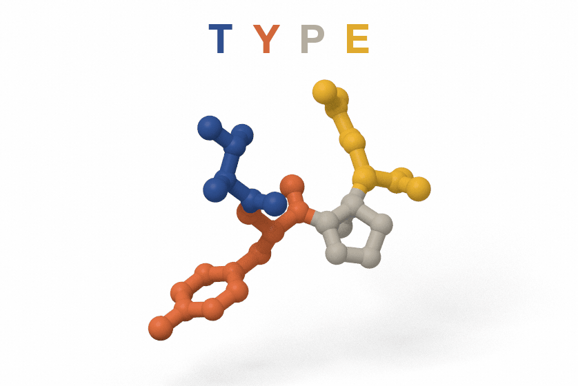
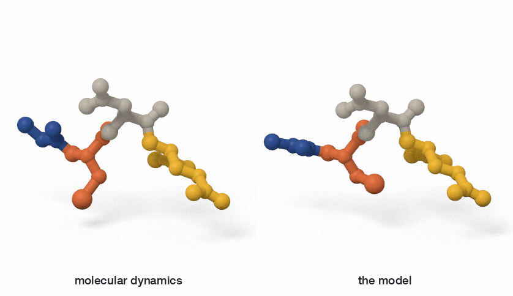
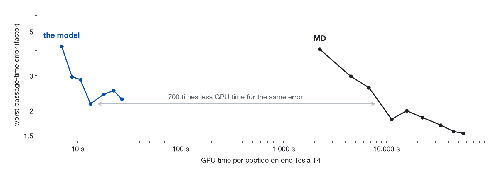
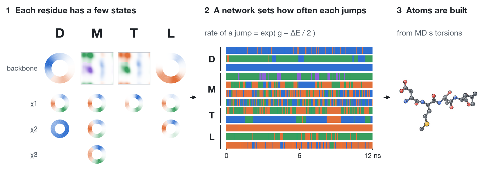

# Peptide dynamics from sequence

**Four letters in, the peptide's motion out.** A network of 0.3 million parameters reads a tetrapeptide's sequence
and nothing else, no structure and no frame of any simulation of it, and writes its dynamics: every heavy atom
every 10 ps, a microsecond in 7 seconds on one CPU core (median of 40 peptides; 73 at most). The molecular
dynamics (MD) it learned from needs six GPU-hours for that microsecond.

<p align="center">
  <picture>
    <source media="(prefers-color-scheme: dark)" srcset="figures/type-dark.gif">
    
  </picture>
</p>

*The peptide TYPE, written by the model from its four letters: 1.5 ns, every third frame. Each joint is drawn at
the typical angle of the position it is in.*

## What it gets right, and where it stops

Scored on the 40 tetrapeptides that the public MD corpus holds out of training, each against its 5 µs of MD
([how](docs/comparison.md), [every number](docs/evidence.md)):

| | the model | MD against itself |
|---|---|---|
| how often each residue jumps | within 8% | within 2% |
| free energies of the peptide's states | 0.36 kT off | 0.20 kT off |
| the worst passage time between states | off by a factor 2.28 | off by a factor 1.53 |
| the peptide's slowest relaxation time | 35% off | 40% off |
| GPU time to the model's passage-time error | 1 | 400 to 700 |

*First row: 20 µs of the model against the 5 µs of MD, and the MD's two halves against each other. The three
rows on states: 2.5 µs of the model, and one half of the MD, each against the other half.*

**Corrected on 12 November 2026.** An earlier version of this page said 1,200 times less GPU time than MD. That
figure compared with MD at only four lengths, on state definitions most of which did not keep the lag rule of
[the comparison](docs/comparison.md). With MD read at more lengths, on states that keep the rule, it is the 400 to
700 above. The earlier page also set the model's free-energy error, 0.26 to 0.39 kT, against 0.35 kT for MD: that
was on the 13 peptides the model was chosen with. At equal length it is 0.36 kT against 0.20 kT.

<p align="center">
  <picture>
    <source media="(prefers-color-scheme: dark)" srcset="figures/twin-dark.gif">
    
  </picture>
</p>

*The held-out peptide GCDE: 0.75 ns of MD beside 0.75 ns from the model, drawn the same way.*

**Each residue's jumps come out right.** The 40 peptides have 408 backbone and side-chain sites, which jump
anywhere from once in 150 ns to 62 times per ns. The model's jump rate is within 8% of MD's (median; 9% on the
ten validation peptides, which nothing was tuned on) and within a factor 1.5 for 95% of the sites. The rarest
jumps are the weak end: the 17 sites that jump less than once in 10 ns are off by 38%, where the MD's halves
differ by 15%, and 15 of them are too fast.

**The peptide's states are close, not at parity with MD.** For 15 of the 40 peptides the MD defines metastable
states. Against 2.5 µs of MD, 2.5 µs of the model gets their free energies wrong by 0.36 kT and its worst
passage time by a factor 2.28; 2.5 µs more of MD, by 0.20 kT and a factor 1.53. On the four validation peptides,
opened only after the model was fixed, it is 0.41 kT against 0.20 kT and a factor 2.47 against 1.93. Which
peptides have states, and which states, leans on the seed of the clustering that finds them: with another seed
17 peptides have states, and it is 0.29 kT against 0.14 kT and a factor 2.18 against 1.35.

**Rare, slow transitions are too fast.** The model's slowest relaxation is faster than MD's in 12 of the 15
peptides, and in 7 of the 8 where it takes more than 5 ns in MD, by a factor 1.9 (median). Where MD's error is
noise, the model's is a bias.

**The reference runs out first.** Two halves of 5 µs of MD disagree on the peptide's slowest relaxation time by
40%, and agree within a factor 1.5 on only 73% of passage times above 100 ns. No peptide's halves meet the
tolerances a certificate would need, and for 25 of the 40 peptides (23 with the other seed) no set of states
reproduces the MD's own relaxation times.

**The same error for hundreds of times less GPU time.** On one Tesla T4, MD needs 22 GPU-seconds per
nanosecond at best; the model, charged the card's whole wall time, needs 13 seconds for a microsecond, atoms
included. To match the passage-time error the model reaches with that microsecond, MD needs 0.4 µs: an estimated
700 times more GPU time, or 400 on the states the other seed gives (MD with 4 fs steps, whose passage times
were not checked, would be 3.2 times cheaper). It ends where the model's accuracy does: MD keeps improving
with length, the model does not.



## How it works



Watched every 10 ps, a peptide mostly sits still and now and then jumps: a backbone hops from one basin of its
(φ, ψ) map to another, a side chain flips from one rotamer to another. The model keeps only that.

1. **States.** Each residue gets one small integer for its backbone and one for each side-chain torsion: 247
   states for the 20 amino acids, read off the training MD as the basins of each angle.
2. **Jumps.** A network reads the sequence and the current states, five residues at a time, and returns an energy
   E for the configuration and a prefactor g for each possible jump, which then happens at the rate
   exp(g − ΔE/2). Because g is the same for a jump and its reverse, detailed balance holds exactly, whatever the
   network learns. It is fitted by maximum likelihood to the jumps in the public MD of 1,500 other
   tetrapeptides, 200 ns each: 3.6 hours on one GPU.
3. **Atoms.** For each frame, each residue's torsion angles are drawn from MD frames of that residue type in
   that state, and the heavy atoms are placed from the angles by geometry. Frames within a state are independent
   draws, so motion faster than a jump is not modelled, and atoms rebuilt this way sit about 0.5 Å from MD's.

No frame of any simulation of the peptide goes in: the model draws its own starting states from the energy it
learned, where MDGen's forward simulation ([Jing et al., 2024](https://arxiv.org/abs/2409.17808)) starts from
the first frame of the MD it emulates. The model in full: [docs/model.md](docs/model.md).

## Run it

```
pip install numpy
python generate.py DMTL          # DMTL.pdb and DMTL.dcd: 1 microsecond, 100,000 frames of 32 heavy atoms
```

```python
import pepdyn
out = pepdyn.generate("DMTL", ns=1000)
out["xyz"]       # (1, 100000, 32, 3), in angstrom
out["states"]    # the jumps themselves: one integer per site and frame
```

Any sequence of the 20 amino acids runs, but only tetrapeptides in implicit solvent at 310 K are scored above,
and the model does not carry over to longer chains: on 30 octapeptides its jump rates are off by 45% (the MD's
halves by 4%), and the 31 rarest by a factor 33.

## Check it

```
python evaluate.py GCDE          # one held-out peptide against the MD stored in data/: under a minute
python evaluate.py --trade       # the table above: model and MD at equal length, on all 15 with states
python tools/recompute.py        # every number on this page, recomputed from results/
python -m pytest                 # detailed balance, the atoms, the estimators, the numbers on this page
```

The two animations were drawn from the same network's paths by a ray tracer that is not in this
repository.

Trained and scored on [ManyPeptidesMD](https://huggingface.co/datasets/transferable-samplers/many-peptides-md)
(Tan et al., 2025; MIT licence). Everything here is CC0 1.0, except what derives from that corpus:
[NOTICE.md](NOTICE.md).
