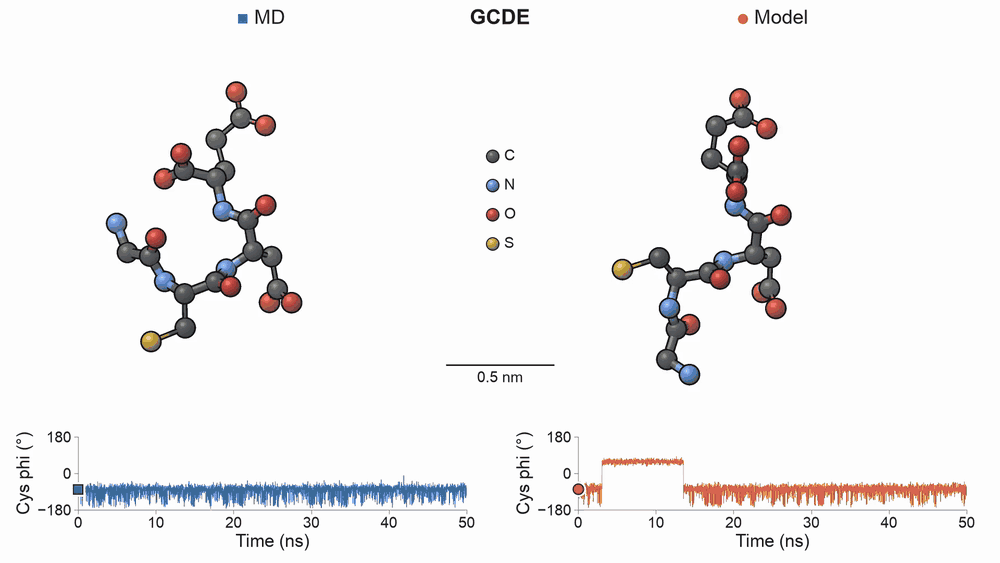
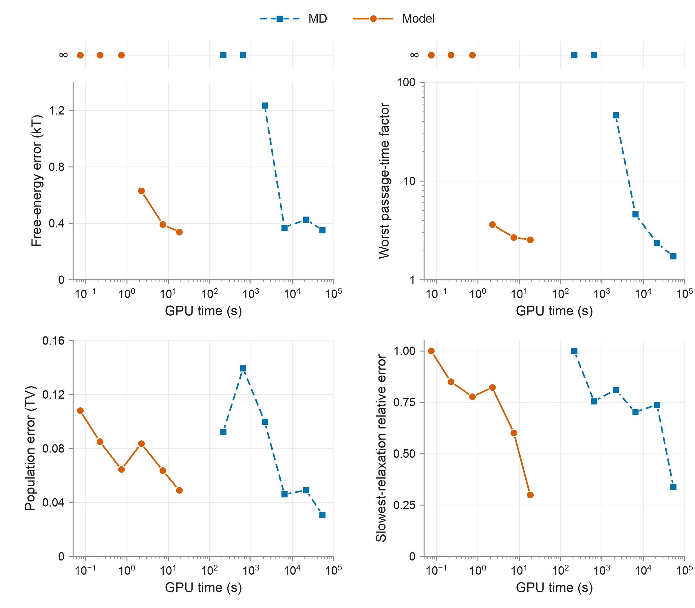
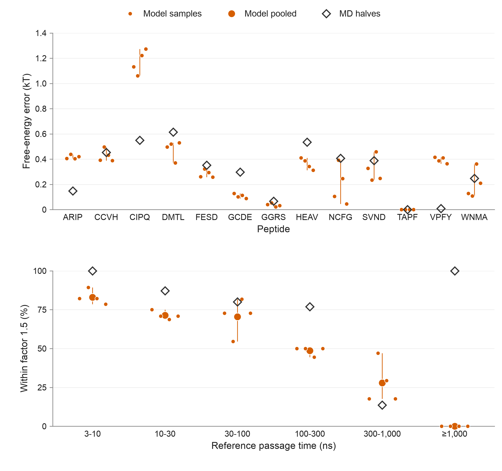
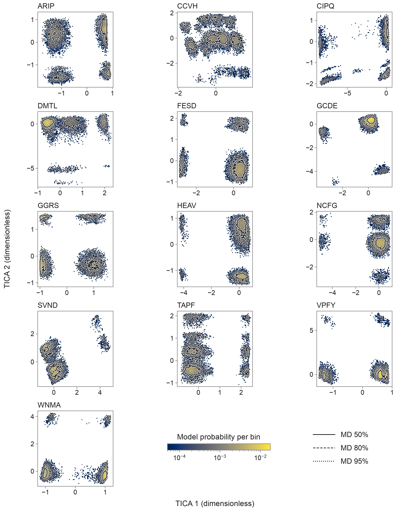

# Peptide dynamics from sequence

Molecular dynamics (MD) simulates atoms moving under physical forces, taking tiny time steps that make even short trajectories expensive. The reference trajectories here use OpenMM with the Amber14 force field (`amber14-all.xml`, ff14SB for proteins), OBC1 generalised Born implicit solvent (`implicit/obc1.xml`, without individual water molecules) and Langevin dynamics at 310 K. A tetrapeptide is a chain of four amino acids; its dynamics describe the shapes it takes, how much time it spends in each (their relative free energies) and how fast it moves between them. This model generates those dynamics from sequence alone using an **estimated 2,900 times less GPU time per nanosecond** than MD.

[](figures/gcde-motion.mp4)

Independent 50 ns paths of GCDE from MD and the sequence model, shown at the same scale and playback rate; click for the MP4. In a separate measurement, generating a full microsecond took **1.8 seconds on a desktop CPU**, including coordinates and file writing.

The estimated cost on one T4 is 0.0074 GPU-seconds per nanosecond for the model, against 21.6 for MD. No simulation frames or starting structure of that peptide are needed.



A 2.49 µs model sample costs an estimated **18.5 GPU-seconds per peptide**. MD needs about 21,600 GPU-seconds to match its median worst passage-time error on the sampled lengths, an estimated **1,200-fold cost reduction**.



Across four model samples, median free-energy error is **0.26 to 0.39 kT**, against **0.35 kT** between the MD halves. For passages taking 3 to 10 ns in MD, **83%** of model estimates are within a factor of 1.5, falling to **28%** for 300 to 1,000 ns; the MD halves score 100% and 14%, respectively.



Colour shows model probability per bin; solid, dashed and dotted MD contours target 50%, 80% and 95% of sampled probability for each peptide. Overlapping conformations alone do not establish correct timing.

[Evidence, definitions and limitations](docs/evidence.md) · [Result files](results/README.md) · [Reproduce the numbers](REPRODUCE.md). MD data: [ManyPeptidesMD](data/README.md).

## What this does not show

- Independent validation: these 13 public test tetrapeptides also chose the model variant. The evidence covers implicit solvent at 310 K only.
- Exact kinetics: the slowest relaxation is at least twice too fast in 5 to 6 peptides per sample. The four samples each contain 5 µs; their spread and the noisy MD halves limit the comparison.
- A universal speed-up: the 1,200-fold comparison matches one error measure. GPU timing uses a same-size sibling bundle, excludes analysis and scales with generated length; the CPU result is one run for one peptide.

## How to use it

The trained bundle is included and loads automatically. From this directory:

```bash
pip install -r requirements.txt
python model/generate.py GCDE output --ns 1000 --trajectories 1
```

Load `output/heavy.pdb` with `output/traj_000.xtc` in a molecular viewer, or read `output/dynamics.npz` for states and torsions. Change `GCDE` to another tetrapeptide; [model/](model/README.md) explains the limits and [REPRODUCE.md](REPRODUCE.md) covers retraining for other data. Free to use: [CC0](LICENSE) for original work, with [MIT terms](NOTICE.md) retained for dataset-derived material.
