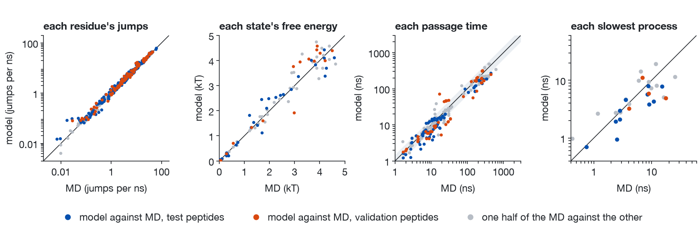
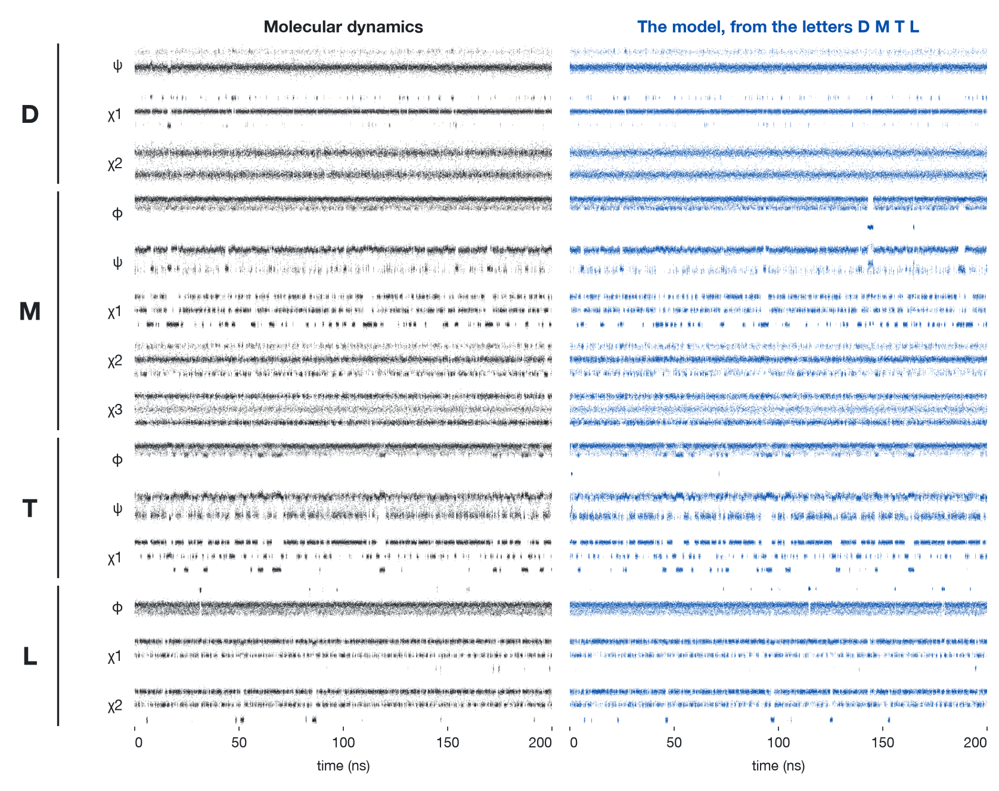
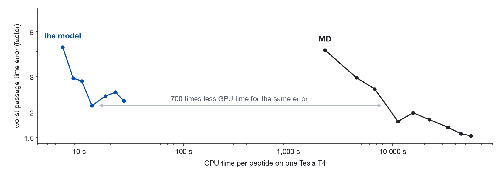

# Where every number comes from

*Every dot is one site, one state, one passage time or one peptide: 5 µs of the model against the MD in colour,
one half of the MD against the other in grey.*

*Every torsion angle of DMTL over 200 ns: MD on the left, the model on the right, which never saw this peptide.
Each strip spans one full turn of one angle. Of the 14 peptides scored on passage times and free energies,
DMTL is the 7th by either error.*

Every number in the README is recomputed from the files in `results/` by `python tools/recompute.py`, and
`python -m pytest` fails if the README or this page quotes anything else. The files in `results/` are written by:

| file | written by | holds |
|---|---|---|
| `held_out.json` | `python evaluate.py --seeds 10` | the 15 peptides whose MD defines states: the model (ten seeds), the whole MD and its two halves |
| `trade.json` | `python evaluate.py --trade --seeds 5` | errors against one half of the MD by simulated length, for the other half and for the model |
| `seed1/held_out.json`, `seed1/trade.json` | the same two with `--references data/reference_seed1`, one and three seeds | the same on the states that another seed of the k-means gives (`tools/make_reference.py --seed 1`) |
| `sites.json` | `python evaluate.py --sites` | populations and jump rates of every site of all 40 held-out peptides |
| `sites_octapeptides.json` | `python evaluate.py --sites --octapeptides` | the same for the corpus's 30 test octapeptides |
| `atoms.json` | `python tools/check_atoms.py` | MD frames rebuilt from their own torsions, against the frames |
| `bank.json` | `python tools/check_bank.py` | how often a generated frame needs a combination of states the torsion bank lacks |
| `timing.json` | `python tools/time_generate.py` | seconds to generate 1 µs of each held-out peptide on one core of an Apple M4 |
| `cost/md_t4.json` | `python tools/time_md.py` | throughput of MD on one Tesla T4 |
| `cost/model_t4.json` | `python tools/time_model_gpu.py` | GPU time of the model on one Tesla T4 |
| `training/train_log.txt` | the training run of the published weights | the likelihood during training, and how long it took on which card |

Generation is random: on another machine the same seeds give other trajectories, and `evaluate.py` gives numbers
that differ from these as two seeds do.

## The peptides, and what each was used for

The corpus, ManyPeptidesMD, has 5 µs of MD for 30 test and 10 validation tetrapeptides, none of them in training.
For 15 of the 40 the MD defines metastable states ([the comparison](comparison.md)); all 40 are scored site by
site.

- **9 test peptides** (below: "test, compared on"). Variants of the model, differing in training-set size,
  time step and the bound on the prefactor, were compared on the MD of 13 test peptides, these nine among them
  (the other four, CIPQ, HEAV, SVND and WNMA, have no states), and these weights were kept for their passage
  times. Their scores are optimistic.
- **2 test peptides**, KKAP and QAKR, which took no part in that comparison.
- **4 validation peptides.** The weights, the state rule and the estimators were fixed before any validation
  trajectory was read, with the rule that all ten would be scored and every result reported.

Two comparisons are made on those 15 ([the comparison](comparison.md), step 5):

- **At equal length** (`trade.json`): 2.49 µs of the model, and 2.49 µs of one half of the MD, each against the
  other half. The README's table quotes this one.
- **In full** (`held_out.json`): 5 µs of the model against all 5 µs of the MD, beside the MD's two halves
  against each other, which hold half the data on each side.

A summary such as "0.27 kT" is the median over peptides within one evaluation (over the 14 with at least two main
states, for passage times and free energies). For the model it is the median of the evaluations with different
seeds, ten in full and five at equal length, and in full the smallest and largest of the ten are given; the MD
has one realisation. In the table of peptides each entry is that peptide's median over the ten seeds.

## The numbers

<!-- numbers -->
| number | value | from `results/` |
|---|---|---|
| all: peptides | 15 | `held_out.json` |
| all: free-energy error, model | 0.27 kT | `held_out.json` |
| all: free-energy error, model, least over seeds | 0.21 kT | `held_out.json` |
| all: free-energy error, model, most over seeds | 0.38 kT | `held_out.json` |
| all: free-energy error, MD halves | 0.20 kT | `held_out.json` |
| all: worst passage-time factor, model | 2.08 | `held_out.json` |
| all: worst passage-time factor, model, least over seeds | 1.96 | `held_out.json` |
| all: worst passage-time factor, model, most over seeds | 2.28 | `held_out.json` |
| all: worst passage-time factor, MD halves | 1.57 | `held_out.json` |
| all: slowest relaxation error, model | 32% | `held_out.json` |
| all: slowest relaxation error, model, least over seeds | 26% | `held_out.json` |
| all: slowest relaxation error, model, most over seeds | 51% | `held_out.json` |
| all: slowest relaxation error, MD halves | 40% | `held_out.json` |
| all: at equal length, worst passage-time factor, model | 2.28 | `trade.json` |
| all: at equal length, worst passage-time factor, MD | 1.53 | `trade.json` |
| all: at equal length, free-energy error, model | 0.36 kT | `trade.json` |
| all: at equal length, free-energy error, MD | 0.20 kT | `trade.json` |
| all: at equal length, slowest relaxation error, model | 35% | `trade.json` |
| all: at equal length, slowest relaxation error, MD | 40% | `trade.json` |
| all: passage times up to 100 ns, number | 88 | `held_out.json` |
| all: passage times up to 100 ns within 1.5, model | 67% | `held_out.json` |
| all: passage times up to 100 ns within 1.5, MD halves | 86% | `held_out.json` |
| all: passage times above 100 ns, number | 44 | `held_out.json` |
| all: passage times above 100 ns within 1.5, model | 57% | `held_out.json` |
| all: passage times above 100 ns within 1.5, MD halves | 73% | `held_out.json` |
| compared on: peptides | 9 | `held_out.json` |
| compared on: free-energy error, model | 0.31 kT | `held_out.json` |
| compared on: free-energy error, model, least over seeds | 0.26 kT | `held_out.json` |
| compared on: free-energy error, model, most over seeds | 0.40 kT | `held_out.json` |
| compared on: free-energy error, MD halves | 0.32 kT | `held_out.json` |
| compared on: worst passage-time factor, model | 2.08 | `held_out.json` |
| compared on: worst passage-time factor, model, least over seeds | 1.96 | `held_out.json` |
| compared on: worst passage-time factor, model, most over seeds | 2.32 | `held_out.json` |
| compared on: worst passage-time factor, MD halves | 1.57 | `held_out.json` |
| compared on: slowest relaxation error, model | 27% | `held_out.json` |
| compared on: slowest relaxation error, model, least over seeds | 21% | `held_out.json` |
| compared on: slowest relaxation error, model, most over seeds | 37% | `held_out.json` |
| compared on: slowest relaxation error, MD halves | 40% | `held_out.json` |
| compared on: at equal length, worst passage-time factor, model | 2.37 | `trade.json` |
| compared on: at equal length, worst passage-time factor, MD | 1.53 | `trade.json` |
| compared on: at equal length, free-energy error, model | 0.40 kT | `trade.json` |
| compared on: at equal length, free-energy error, MD | 0.30 kT | `trade.json` |
| compared on: at equal length, slowest relaxation error, model | 32% | `trade.json` |
| compared on: at equal length, slowest relaxation error, MD | 40% | `trade.json` |
| compared on: passage times up to 100 ns, number | 49 | `held_out.json` |
| compared on: passage times up to 100 ns within 1.5, model | 73% | `held_out.json` |
| compared on: passage times up to 100 ns within 1.5, MD halves | 86% | `held_out.json` |
| compared on: passage times above 100 ns, number | 17 | `held_out.json` |
| compared on: passage times above 100 ns within 1.5, model | 59% | `held_out.json` |
| compared on: passage times above 100 ns within 1.5, MD halves | 59% | `held_out.json` |
| validation: peptides | 4 | `held_out.json` |
| validation: free-energy error, model | 0.39 kT | `held_out.json` |
| validation: free-energy error, model, least over seeds | 0.22 kT | `held_out.json` |
| validation: free-energy error, model, most over seeds | 0.49 kT | `held_out.json` |
| validation: free-energy error, MD halves | 0.19 kT | `held_out.json` |
| validation: worst passage-time factor, model | 3.14 | `held_out.json` |
| validation: worst passage-time factor, model, least over seeds | 2.51 | `held_out.json` |
| validation: worst passage-time factor, model, most over seeds | 3.64 | `held_out.json` |
| validation: worst passage-time factor, MD halves | 1.93 | `held_out.json` |
| validation: slowest relaxation error, model | 46% | `held_out.json` |
| validation: slowest relaxation error, model, least over seeds | 13% | `held_out.json` |
| validation: slowest relaxation error, model, most over seeds | 58% | `held_out.json` |
| validation: slowest relaxation error, MD halves | 39% | `held_out.json` |
| validation: at equal length, worst passage-time factor, model | 2.47 | `trade.json` |
| validation: at equal length, worst passage-time factor, MD | 1.93 | `trade.json` |
| validation: at equal length, free-energy error, model | 0.41 kT | `trade.json` |
| validation: at equal length, free-energy error, MD | 0.20 kT | `trade.json` |
| validation: at equal length, slowest relaxation error, model | 49% | `trade.json` |
| validation: at equal length, slowest relaxation error, MD | 39% | `trade.json` |
| validation: passage times up to 100 ns, number | 33 | `held_out.json` |
| validation: passage times up to 100 ns within 1.5, model | 52% | `held_out.json` |
| validation: passage times up to 100 ns within 1.5, MD halves | 85% | `held_out.json` |
| validation: passage times above 100 ns, number | 25 | `held_out.json` |
| validation: passage times above 100 ns within 1.5, model | 52% | `held_out.json` |
| validation: passage times above 100 ns within 1.5, MD halves | 80% | `held_out.json` |
| all: peptides with at least two main states | 14 | `held_out.json` |
| recording: DMTL, place by worst passage-time factor, least first | 7 | `held_out.json` |
| recording: DMTL, place by free-energy error, least first | 7 | `held_out.json` |
| slow: peptides slower than 5 ns in MD | 8 | `held_out.json` |
| slow: of which the model is faster | 7 | `held_out.json` |
| slow: by a median factor | 1.9 | `held_out.json` |
| slow: peptides whose slowest relaxation is faster in the model | 12 | `held_out.json` |
| reference: peptides whose halves meet every tolerance | 0 | `held_out.json` |
| reference: peptides on which both controls fail | 15 | `held_out.json` |
| atoms: frames drawn again, least | 6% | `held_out.json` |
| atoms: frames drawn again, most | 35% | `held_out.json` |
| atoms: frames left overlapping, most | 0.2% | `held_out.json` |
| atoms: rebuilt MD frames, RMSD from | 0.51 | `atoms.json` |
| atoms: rebuilt MD frames, RMSD to | 0.57 | `atoms.json` |
| atoms: frames that borrow another combination's torsions | 0.02% | `bank.json` |
| atoms: the same, most for one peptide | 0.3% | `bank.json` |
| sites: peptides | 40 | `sites.json` |
| sites: sites | 408 | `sites.json` |
| sites: jump rate, model | 8% | `sites.json` |
| sites: jump rate, MD halves | 2% | `sites.json` |
| sites: jump rates within 1.5, model | 95% | `sites.json` |
| sites: jump rates within 1.5, MD halves | 100% | `sites.json` |
| sites: site free energy, model | 0.17 kT | `sites.json` |
| sites: site free energy, MD halves | 0.09 kT | `sites.json` |
| sites: slowest site, jumps per ns | 0.007 | `sites.json` |
| sites: fastest site, jumps per ns | 62 | `sites.json` |
| sites: sites that jump less than once in 10 ns | 17 | `sites.json` |
| sites: their jump rate, model | 38% | `sites.json` |
| sites: their jump rate, MD halves | 15% | `sites.json` |
| sites: of them, faster in the model than in the MD | 15 | `sites.json` |
| sites: validation, jump rate, model | 9% | `sites.json` |
| sites: validation, jump rate, MD halves | 2% | `sites.json` |
| sites: validation, site free energy, model | 0.19 kT | `sites.json` |
| sites: validation, site free energy, MD halves | 0.07 kT | `sites.json` |
| octapeptides: peptides | 30 | `sites_octapeptides.json` |
| octapeptides: sites | 618 | `sites_octapeptides.json` |
| octapeptides: jump rate, model | 45% | `sites_octapeptides.json` |
| octapeptides: jump rate, MD halves | 4% | `sites_octapeptides.json` |
| octapeptides: jump rates within 1.5, model | 53% | `sites_octapeptides.json` |
| octapeptides: jump rates within 1.5, MD halves | 98% | `sites_octapeptides.json` |
| octapeptides: site free energy, model | 0.70 kT | `sites_octapeptides.json` |
| octapeptides: site free energy, MD halves | 0.34 kT | `sites_octapeptides.json` |
| octapeptides: sites that jump less than once in 10 ns | 31 | `sites_octapeptides.json` |
| octapeptides: their jump rate, model, a factor | 33 | `sites_octapeptides.json` |
| octapeptides: their jump rate, MD halves | 18% | `sites_octapeptides.json` |
| cost: MD, GPU seconds per ns | 22 | `cost/md_t4.json` |
| cost: MD, GPU hours per microsecond | 6.2 | `cost/md_t4.json` |
| cost: MD with 4 fs steps, times cheaper | 3.2 | `cost/md_t4.json` |
| cost: model, GPU seconds per microsecond | 13 | `cost/model_t4.json` |
| cost: model, GPU seconds per microsecond, least | 8 | `cost/model_t4.json` |
| cost: model, GPU seconds per microsecond, most | 25 | `cost/model_t4.json` |
| cost, all: model's passage-time error with 1 microsecond | 2.2 | `trade.json` |
| cost, all: MD needed to match, microseconds | 0.4 | `trade.json` |
| cost, all: MD needed to match, GPU hours | 2.4 | `trade.json, cost/` |
| cost, all: ratio of GPU times | 700 | `trade.json, cost/` |
| cost, compared on: model's passage-time error with 1 microsecond | 2.2 | `trade.json` |
| cost, compared on: MD needed to match, microseconds | 0.4 | `trade.json` |
| cost, compared on: MD needed to match, GPU hours | 2.7 | `trade.json, cost/` |
| cost, compared on: ratio of GPU times | 700 | `trade.json, cost/` |
| other seed: peptides with states | 17 | `../data/reference_seed1/` |
| other seed: peptides that gain states | 3 | `../data/reference_seed1/` |
| other seed: peptides that lose them | 1 | `../data/reference_seed1/` |
| other seed: peptides that keep them | 14 | `../data/reference_seed1/` |
| other seed: of those, with another number of states | 7 | `../data/reference_seed1/` |
| other seed: at equal length, worst passage-time factor, model | 2.18 | `seed1/trade.json` |
| other seed: at equal length, worst passage-time factor, MD | 1.35 | `seed1/trade.json` |
| other seed: at equal length, free-energy error, model | 0.29 kT | `seed1/trade.json` |
| other seed: at equal length, free-energy error, MD | 0.14 kT | `seed1/trade.json` |
| other seed: at equal length, slowest relaxation error, model | 50% | `seed1/trade.json` |
| other seed: at equal length, slowest relaxation error, MD | 40% | `seed1/trade.json` |
| other seed: MD needed to match, microseconds | 0.2 | `seed1/trade.json` |
| other seed: ratio of GPU times | 400 | `seed1/trade.json, cost/` |
| timing: seconds per microsecond on one CPU core, median | 7 | `timing.json` |
| timing: seconds per microsecond, fastest | 1.5 | `timing.json` |
| timing: seconds per microsecond, slowest | 73 | `timing.json` |

| peptide | set | worst passage time | free energy (kT) | populations | slowest relaxation | other relaxations | slowest relaxation, model / MD (ns) |
|---|---|---|---|---|---|---|---|
| ARIP | test, compared on | 2.78 / 1.32 | 0.40 / 0.15 | 0.20 / 0.06 | 24% / 3% | 44% / 6% | 2.1 / 2.8 |
| CCVH | test, compared on | 1.81 / 1.59 | 0.43 / 0.45 | 0.02 / 0.02 | 31% / 4% | 67% / 24% | 4.6 / 3.5 |
| DMTL | test, compared on | 2.11 / 2.15 | 0.28 / 0.61 | 0.01 / 0.01 | 57% / 40% | 35% / 100% | 3.8 / 9.0 |
| FESD | test, compared on | 2.19 / 2.92 | 0.26 / 0.35 | 0.07 / 0.04 | 49% / 40% | 159% / 12% | 7.8 / 15.2 |
| GCDE | test, compared on | 1.65 / 1.55 | 0.12 / 0.30 | 0.01 / 0.03 | 32% / 34% | 54% / 24% | 5.8 / 8.5 |
| GGRS | test, compared on | 1.07 / 1.10 | 0.03 / 0.07 | 0.02 / 0.04 | 5% / 4% | 44% / 0% | 3.0 / 2.8 |
| NCFG | test, compared on | 2.46 / 1.80 | 0.39 / 0.41 | 0.01 / 0.03 | 60% / 49% | 41% / 25% | 4.3 / 10.8 |
| TAPF | test, compared on | one main state | one main state | 0.06 / 0.00 | 6% / 57% | 0% / 0% | 0.7 / 0.7 |
| VPFY | test, compared on | 2.12 / 1.08 | 0.39 / 0.01 | 0.14 / 0.01 | 14% / 218% | 39% / 7% | 8.0 / 8.8 |
| KKAP | test | 1.29 / 1.08 | 0.10 / 0.06 | 0.04 / 0.03 | 62% / 56% | 23% / 47% | 0.9 / 2.5 |
| QAKR | test | 1.36 / 1.36 | 0.09 / 0.12 | 0.03 / 0.01 | 24% / 14% | 47% / 46% | 1.9 / 2.4 |
| CVNR | validation | 1.34 / 1.26 | 0.10 / 0.09 | 0.01 / 0.01 | 21% / 24% | 32% / 23% | 3.2 / 4.1 |
| GNFL | validation | 3.53 / 2.19 | 0.35 / 0.25 | 0.02 / 0.02 | 72% / 119% | 15% / 26% | 5.0 / 17.7 |
| LFTE | validation | 4.22 / 2.94 | 0.34 / 0.35 | 0.03 / 0.03 | 33% / 55% | 53% / 39% | 5.9 / 8.9 |
| PMWS | validation | 2.59 / 1.67 | 0.60 / 0.14 | 0.13 / 0.02 | 62% / 7% | 48% / 54% | 11.2 / 6.9 |
<!-- /numbers -->

Entries of the second table are, in full, the model against the MD / one half of the MD against the other.

## The estimate of cost

MD is timed on one Tesla T4 with the corpus's own protocol (1 fs steps, no constraints), as 1, 4, 8, 12 and 16
simulations of one peptide sharing the card: eight give the most, and that is the figure used. The model is timed
on the same kind of card: its jump process on the GPU, its torsions and atoms on the host's CPU, the whole wall
time charged to the card, 1 µs as 100 trajectories of 10 ns. It does not need the card: `timing.json` is the same
microsecond on one CPU core.

"Matched passage-time error" is read off `trade.json`: the worst passage-time error (median over peptides) that
1 µs of model trajectories reaches against one half of the MD, and the length of the other half at which MD's
error first falls to it, interpolated between the lengths scored. Both curves are noisy, MD's is a single
realisation, and the ratio moves by tens of per cent with the choice of peptides and from 700 to 400 with the
seed of the clustering that defines the states: it is an estimate. At every length scored, MD of equal length is
the more accurate, and beyond 1 µs it keeps improving where the model does not
([figure](../figures/cost.png)).

## What can be rebuilt

- **The references.** `tools/make_reference.py` makes a file of `data/reference/` from the corpus's raw
  trajectory. Run again on all 40 peptides it gives the same verdict (states or none) for each, the same number
  of states, the same main states, the same state for more than 99.7% of frames (k-means runs on several threads and does
  not converge to the last digit) and identical site statistics. Run on one octapeptide with `--sites-only` it
  gives the file of `data/octapeptides/` exactly.
- **The model file.** `train/prepare.py` and `train/export.py`, run on torsion tables of the 1,500 training
  trajectories and the published weights, rebuild `models/implicit-310K.npz` array for array: the same states,
  torsion bank and baseline. `train/tables.py` makes those tables from the corpus's raw trajectories (checked on
  three of them: equal to 0.002 rad, the last digit stored).
- **The weights.** `train/train.py`, run again for 6,000 steps on the same tables (an hour on an A100), follows
  the validation likelihood of `training/train_log.txt` within 0.004 at every step logged and ends at 2.4194
  against 2.4192. Its minibatches are not the published run's, whose training values differ. Scored in full on the 15
  peptides with five seeds, the weights it gives are off by 0.25 kT and a factor 1.85 where the published ones,
  with the same seeds, are off by 0.26 kT and a factor 2.08.
- **The residue geometry.** `tools/make_residue_library.py` measures `pepdyn/residues.json` on the starting
  structures of the corpus's test peptides. It is the force field's template geometry, not theirs: measured on
  the 1,500 training tetrapeptides instead, no bond length differs by more than 0.002 Å and no angle by more
  than 0.13°.
- **The port.** `tests/torch_reference.npz` holds outputs of the PyTorch network the weights were trained in
  (`train/network.py`); the numpy network of `pepdyn/model.py` reproduces them to 2 × 10⁻⁶.
